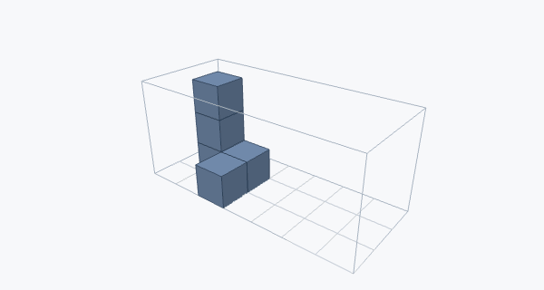

# Spatial Reasoning Benchmark

<p align="center">
  
</p>

[](https://github.com/Ammaar-Alam/project-01-spatial-reasoning/actions/workflows/ci.yml)

A COS 597C Project 1 benchmark by Ammaar Alam and Erik Dyer for evaluating spatial reasoning through one-shot construction and manipulation tasks.

Each task gives a model a starting structure or images, a goal, and any constraints. The model answers once with the complete final structure as JSON, or says the task is impossible. A strict grader scores every answer as pass or fail.

The suite covers spatial transformations, reconstruction from images and viewpoint changes, and constrained editing puzzles.

## Setup

Requires Node.js 24.11 or newer and pnpm.

```sh
pnpm install
```

## Commands

| Command | What it does |
| --- | --- |
| `pnpm tasks:check` | Loads every task in `tasks/` and confirms its reference answer passes the grader |
| `pnpm test` | Runs the unit tests |
| `pnpm check` | Lint, typecheck, tests and task check, the same as CI |
| `pnpm format` | Formats and fixes lint issues in place |
| `pnpm bench` | Sends tasks to models and grades their answers, see [Running models](#running-models) |
| `pnpm editor` | Opens the block editor and results viewer at http://127.0.0.1:4173, see [Editor](#editor) |

## Tasks

Everything about a task lives in one JSON file: the prompt, the starting blocks, the rules, and the answer key. To add a task:

1. Build it in the [editor](#editor) and save, or create `tasks/<family>/<name>.json` by hand. A new family is a new folder.
2. Put any images in the same family folder, or a subfolder of it, and list them in `images`. The editor does this for its snapshots.
3. Run `pnpm tasks:check`.
4. Run `pnpm bench --dry-run --tasks <family>/<name>` to see exactly what a model will receive.

No other file or code changes. The path gives the task its id, for example `tasks/transform/mirror-l-01.json` is `transform/mirror-l-01`. Names use lowercase letters, digits and hyphens.

```json
{
  "prompt": "Mirror the structure across the plane x = 3.5.",
  "size": { "x": 8, "y": 4, "z": 4 },
  "initial": [{ "x": 1, "y": 0, "z": 0 }, { "x": 2, "y": 0, "z": 0 }, { "x": 1, "y": 1, "z": 0 }],
  "constraints": { "maxEdits": 6 },
  "reference": {
    "status": "solved",
    "blocks": [{ "x": 6, "y": 0, "z": 0 }, { "x": 5, "y": 0, "z": 0 }, { "x": 6, "y": 1, "z": 0 }]
  }
}
```

The model sees the prompt, the grid size, the starting blocks, the images and every rule in `constraints`, so the prompt only needs to state the goal.

| Field | Required | Meaning |
| --- | --- | --- |
| `prompt` | yes | The instruction shown to the model |
| `size` | yes | Grid dimensions. Coordinates run from 0 to size - 1, and y is up |
| `initial` | no | Blocks present at the start. Defaults to none |
| `images` | no | PNG, JPEG or WebP files shown to the model, inside the family folder, with paths relative to the task file |
| `constraints` | no | Rules the answer must follow, listed below |
| `parent` | no | Groups variations of one puzzle. Defaults to the task id |
| `reference` | yes | The correct answer, in the same format a model uses. Never shown to the model |
| `alternatives` | no | Other final structures that are also correct, for tasks with more than one valid answer |

| Constraint | Rule |
| --- | --- |
| `maxEdits`, `exactEdits` | Limit on added plus removed blocks, compared between the initial and final structures. Moving a block counts as 2 edits |
| `maxBlocks`, `exactBlocks` | Limit on the number of blocks in the final structure |
| `protected` | Cells that must be the same before and after, whether filled or empty |
| `only` | `"add"` or `"remove"` to allow only one kind of edit |

## Answers

A model replies with exactly one JSON object, either the full final structure or a claim that the task cannot be solved:

```json
{ "status": "solved", "blocks": [{ "x": 0, "y": 0, "z": 0 }] }
```

```json
{ "status": "impossible", "reason": "The digit needs at least 5 edits." }
```

One surrounding ` ```json ` fence is allowed. Any other text, a second JSON object, extra fields, non-integer coordinates, blocks outside the grid, or the same block listed twice fails the answer. Nothing is repaired or retried.

An answer passes when it follows every constraint and its blocks exactly match the reference or one of the alternatives, in any order. On a task whose reference is `impossible`, only an `impossible` answer passes. The reason is kept for review but not scored.

## Running models

Copy `.env.example` to `.env` and fill in the keys for the providers you use. Models are listed in `models.json`:

```json
"claude-opus-5-5": {
  "provider": "anthropic",
  "model": "claude-opus-5-5",
  "params": { "max_tokens": 128000, "output_config": { "effort": "max" } }
}
```

`provider` is `anthropic`, `openai`, `gemini` or `openrouter`, and `model` is the id that provider's API expects. `params` is added to the request as written, so output limits and reasoning settings live here. Adding a model is one new entry.

```sh
pnpm bench --dry-run --tasks transform
pnpm bench --name pilot --models claude-opus-5-5,glm-5.3 --attempts 3
```

| Flag | Meaning |
| --- | --- |
| `--name` | Run name. Results go to `results/<name>/` |
| `--models` | Comma-separated names from `models.json` |
| `--tasks` | Comma-separated families or task ids. Defaults to every task |
| `--attempts` | Independent attempts per task and model. Defaults to 1 |
| `--concurrency` | Requests in flight at once. Defaults to 4 |
| `--dry-run` | Prints what each model would receive and calls nothing |

Each attempt is exactly one request, with no retries, repairs or feedback, and OpenRouter is not allowed to fall back to another provider. A request is given up after 3 hours. OpenAI requests with `"background": true` are polled until they finish, which does not send the task again.

A run writes:

- `results/<name>/run.json` holds the attempt count, system prompt, model settings, a hash of every task, a hash of the code and locked dependencies, the start time and the commit the code was run from.
- `results/<name>/tasks/` is a copy of every task file and image the run used, in the same layout as `tasks/`, so the inputs and answer keys survive later edits and can be regraded.
- `results/<name>/records.jsonl` gets one line per attempt as soon as it finishes: task, model, attempt number, timing, the raw reply, pass or fail with failure codes, the stop reason, any refusal text, and token usage and cost as the provider reported them. A reply the provider marks as a refusal, including a safety block reported as an error or a reply a content filter stopped, fails with `refused`, even if its text happens to be a correct answer, and the refusal text is kept.

A request that fails before producing an answer, such as a network error, a provider outage, or an upstream error OpenRouter reports inside a normal response, is saved with `"status": "error"` and is not graded. Running the same command again retries only those attempts. For an OpenAI background request, the response id is saved with `"status": "started"` as soon as OpenAI accepts it, so a later run keeps checking that response instead of sending the task again, and its latency still counts from when it was first sent. A run can only be resumed with the same settings, task files and code, so changing any of them needs a new run name. If a crash cuts off the last line of `records.jsonl`, the next run moves that partial line to `records.jsonl.partial` and retries the attempt. Only one command can work on a run name at a time; a second one stops with an error instead of sending the same attempts again.

## Editor

`pnpm editor` serves a local page for building tasks and reading results. It listens on 127.0.0.1 only; `--port` picks another port.

**Build** edits one task at a time. Click a block face or the floor to add a block, shift-click a block to remove it, drag to turn the view, and Reset view brings the starting view back. The blocks sit in layers:

- **Start** is `initial`, the structure the model is given.
- **Answer** is the `reference` structure, unless the task is marked impossible.
- **Protected** is `constraints.protected`.
- **Alternative 1, 2, …** are `alternatives`.

Save writes `tasks/<family>/<name>.json`, but only if the task passes the same checks as `pnpm tasks:check`; otherwise the page shows why and nothing is written. Saving a new task never overwrites an existing one.

Snapshot saves the current layer as a 1024 by 768 PNG next to the task and adds it to `images`. Every view frames the whole grid, so tasks with the same grid size get the same framing:

| View | Camera |
| --- | --- |
| Front | Looks along -z, x to the right and y up, without perspective |
| Side | Looks along -x, z to the left and y up, without perspective |
| Top | Looks straight down, x to the right and z down the image, without perspective |
| Angled | From the +x, +y, +z corner, with perspective |

**Results** opens any run in `results/` without calling a model. Each attempt is drawn over the closest correct structure: matching blocks in blue, missing blocks as red outlines, extra blocks in amber. The prompt, images, failures and raw reply sit beside it.

[docs/architecture.md](docs/architecture.md) has diagrams of the data model, the grading flow, a run and the editor, plus every failure code.

## License

[MIT](LICENSE)
