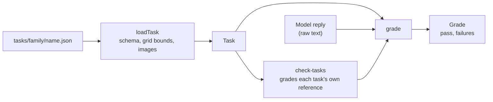
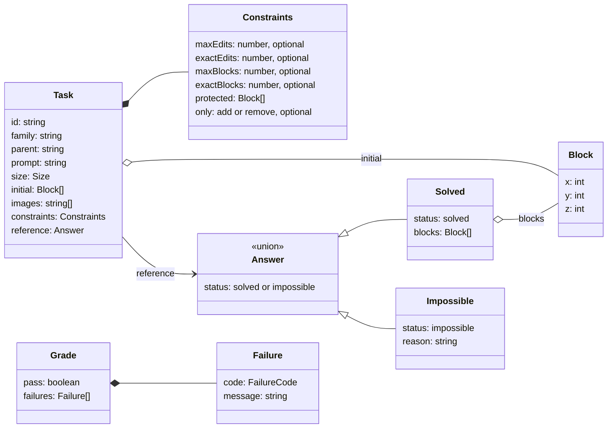
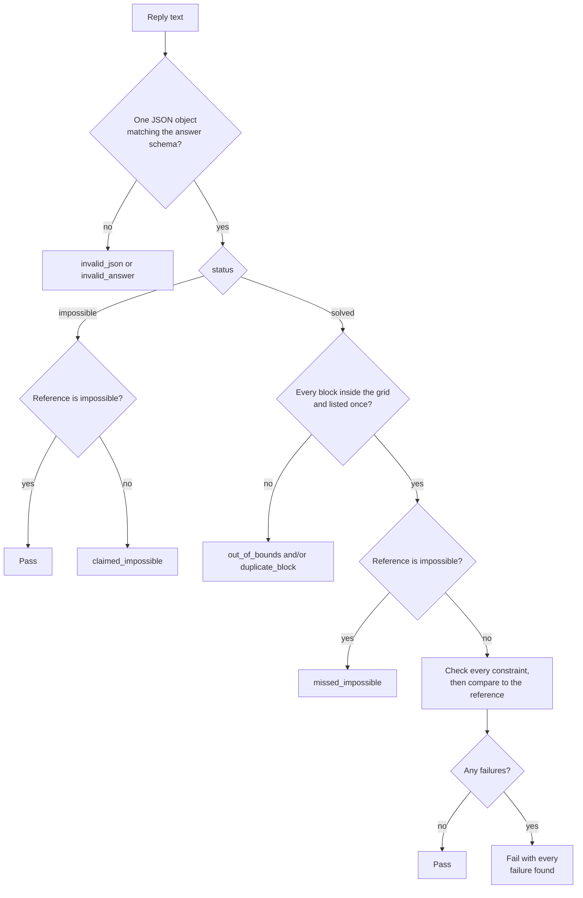
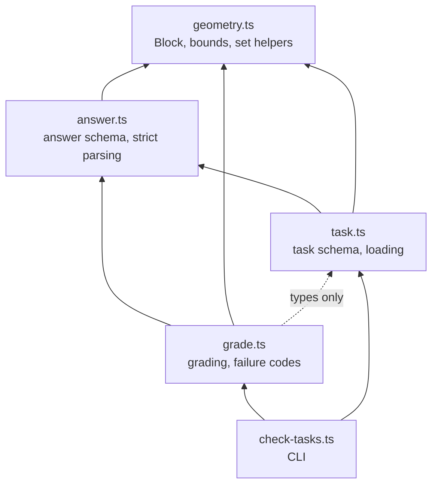

# Architecture

This page describes how tasks are stored, how a model's answer is graded, and how the source modules depend on each other.

## Overview



A task file is loaded and validated once. Grading takes the loaded task and the model's raw reply text and returns a pass or fail with the list of failures. `pnpm tasks:check` runs every task's reference answer through the same grader, so a task cannot enter the benchmark if its own answer breaks its rules.

## Data model



A model's answer and a task's reference use the same `Answer` format. That is what lets `check-tasks` grade the reference like any other answer.

`id`, `family` and `parent` are not stored in the file. The loader takes `id` and `family` from the path, and `parent` defaults to the id.

## Grading



Parsing accepts the whole reply as one JSON value, optionally inside one ` ```json ` fence. It never picks one object out of several, and it never repairs an answer.

Constraint checks and the structure comparison all run, so a failing answer reports every rule it broke instead of only the first.

### Counting edits

Edits compare the initial structure `S` with the final structure `F`. They do not depend on the order the model might have imagined making changes.

- added = blocks in `F` that are not in `S`
- removed = blocks in `S` that are not in `F`
- edits = added + removed

Moving one block from `(0, 0, 0)` to `(1, 0, 0)` is 1 removal plus 1 addition, so 2 edits.

### Failure codes

| Code | Meaning |
| --- | --- |
| `invalid_json` | The reply is not exactly one JSON value |
| `invalid_answer` | The JSON does not match the answer schema |
| `out_of_bounds` | A block is outside the task's grid |
| `duplicate_block` | The same block is listed more than once |
| `claimed_impossible` | The answer says impossible, but the task has a solution |
| `missed_impossible` | The answer builds a structure, but the task has no solution |
| `too_many_edits` | More edits than `maxEdits` |
| `wrong_edit_count` | Edits differ from `exactEdits` |
| `too_many_blocks` | More final blocks than `maxBlocks` |
| `wrong_block_count` | Final block count differs from `exactBlocks` |
| `protected_changed` | A protected cell was filled or emptied |
| `forbidden_edit` | A removal in an add-only task, or an addition in a remove-only task |
| `wrong_structure` | The final blocks differ from the reference |

## Modules



Arrows point from a module to the module it imports. There are no import cycles. File system access is limited to `findTaskFiles` and `loadTask` in `task.ts`, so parsing and grading are pure functions. Tests sit next to the module they cover as `*.test.ts` and run with Node's built-in test runner.
