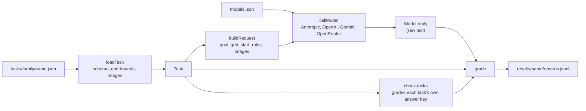
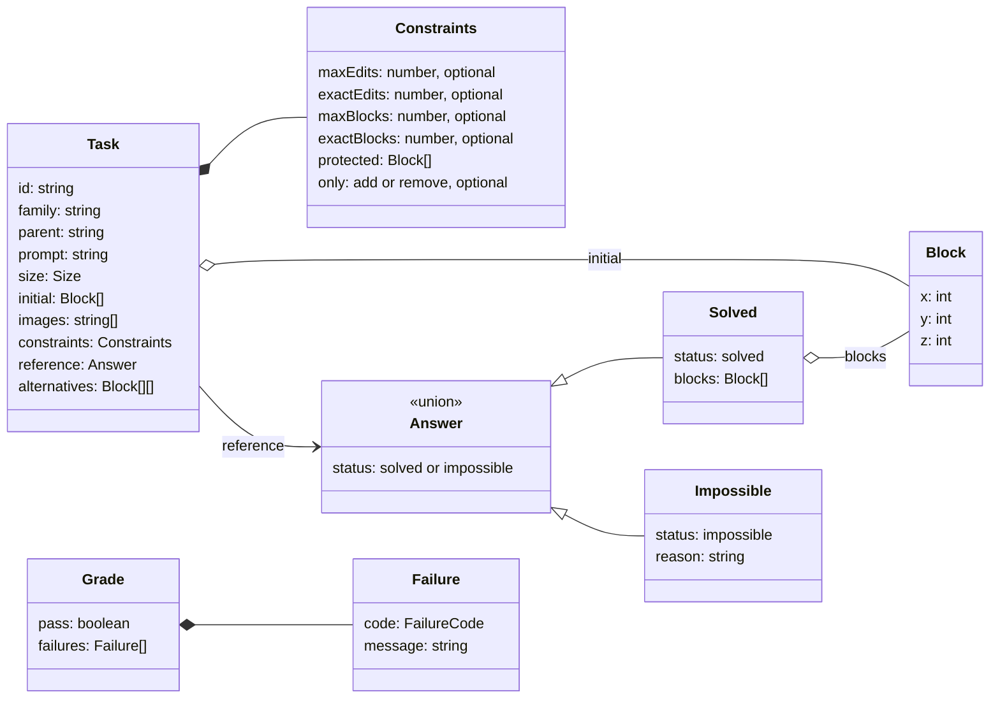
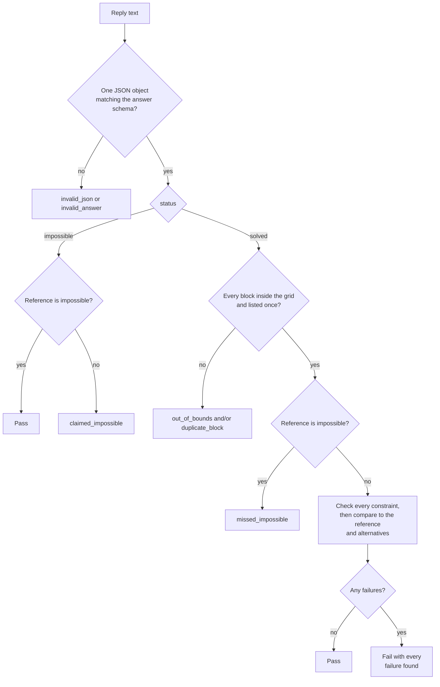
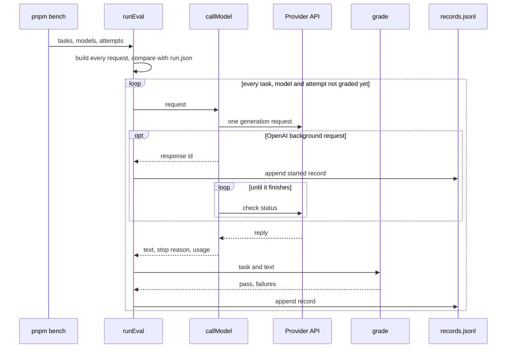
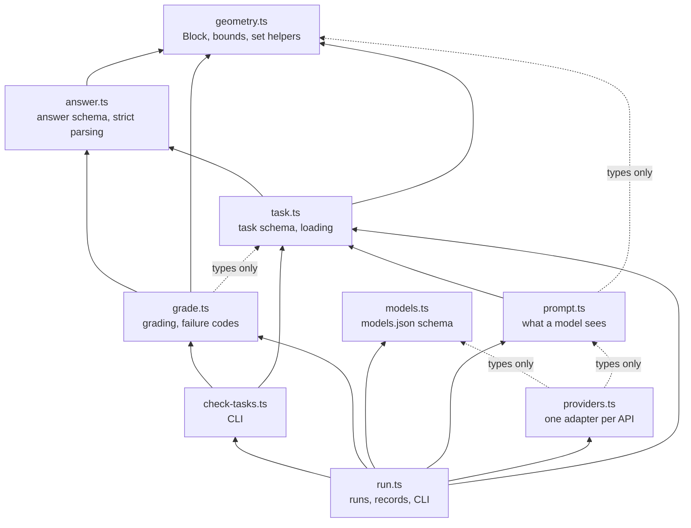

# Architecture

This page describes how tasks are stored, how models are run on them, how answers are graded, and how the source modules depend on each other.

## Overview



A task file is loaded and validated once. `buildRequest` turns it into the only thing a model ever receives, and the answer key never leaves the grader. Grading takes the loaded task and the model's raw reply text and returns a pass or fail with the list of failures. `pnpm tasks:check` runs every task's reference answer and alternatives through the same grader, so a task cannot enter the benchmark if its own answer key breaks its rules.

## Data model



A model's answer and a task's reference use the same `Answer` format. That is what lets `check-tasks` grade the reference and each alternative like any other answer.

`id`, `family` and `parent` are not stored in the file. The loader takes `id` and `family` from the path, and `parent` defaults to the id.

## Grading



Parsing accepts the whole reply as one JSON value, optionally inside one ` ```json ` fence. It never picks one object out of several, and it never repairs an answer.

Constraint checks and the structure comparison all run, so a failing answer reports every rule it broke instead of only the first.

### Counting edits

Edits compare the initial structure `S` with the final structure `F`. They do not depend on the order the model might have imagined making changes.

- added = blocks in `F` that are not in `S`
- removed = blocks in `S` that are not in `F`
- edits = added + removed

Moving one block from `(0, 0, 0)` to `(1, 0, 0)` is 1 removal plus 1 addition, so 2 edits.

### Failure codes

| Code | Meaning |
| --- | --- |
| `invalid_json` | The reply is not exactly one JSON value |
| `invalid_answer` | The JSON does not match the answer schema |
| `out_of_bounds` | A block is outside the task's grid |
| `duplicate_block` | The same block is listed more than once |
| `claimed_impossible` | The answer says impossible, but the task has a solution |
| `missed_impossible` | The answer builds a structure, but the task has no solution |
| `too_many_edits` | More edits than `maxEdits` |
| `wrong_edit_count` | Edits differ from `exactEdits` |
| `too_many_blocks` | More final blocks than `maxBlocks` |
| `wrong_block_count` | Final block count differs from `exactBlocks` |
| `protected_changed` | A protected cell was filled or emptied |
| `forbidden_edit` | A removal in an add-only task, or an addition in a remove-only task |
| `wrong_structure` | The final blocks match neither the reference nor any alternative. The message lists the blocks missing and extra compared with the closest one |
| `refused` | The provider marked the reply as a refusal. Set by the runner before the text is graded |

## Runs



Every attempt is one generation request. The SDK retry loops are turned off and a failed request is never sent again within a run. OpenRouter's fallback to a second provider is turned off for the same reason, so a failed upstream is a failed call. Checking on an OpenAI background request is allowed because it does not generate anything new.

Every request may take up to 30 minutes. Node's `fetch` otherwise gives up after 5 minutes without receiving a byte, which a long generation that is not streamed can exceed, so all providers send through an undici `Agent` whose header and body timeouts match that limit.

If the request fails, the attempt is appended with `"status": "error"` instead of being graded. The next run with the same name skips every graded attempt and retries the rest, so earlier lines stay in the file as a record of what happened. A crash partway through writing a line leaves it cut off, so the next run moves that partial line to `records.jsonl.partial` before reading the file, and the attempt it belonged to is retried.

A run holds `run.lock`, containing its process id, from before it reads `run.json` until it finishes. A second command on the same run name stops with an error, so two processes never send the same attempt. A lock whose process is no longer running, left by a run that was killed, is taken over by the next one. If the run itself fails, for example while saving a record, no new attempts start, and the run waits for requests already sent to finish and be saved before it stops and releases the lock.

Newer OpenAI models can write commentary messages before the final answer. Messages marked as commentary are left out of the reply text, so the grader sees only the answer.

An OpenAI background request is saved with `"status": "started"` and its response id as soon as OpenAI accepts it. If polling fails or the process stops, the next run polls that same response instead of generating a new one, and its latency still runs from when it was first sent. It only sends the task again when the saved response failed, was cancelled, or no longer exists. Whether the answer came from the saved response is decided by the response id on the reply, and an answer from a new request is timed from that request alone.

OpenRouter can return HTTP 200 with an `error` on the choice when the upstream model fails partway. That is treated as a failed call, saved as an error and retried, rather than graded as the model's answer. A refusal, by contrast, is the model's answer: it fails with `refused` before the text is graded, even if the text would pass, and the refusal is kept in the `refusal` field. OpenRouter can also report a refusal as an error, either an HTTP 403 or an error body inside a 200, with `error_type` set to `refusal` or `content_policy_violation`. Those are refusals too, since sending the task again would get the same answer.

When a run starts it copies every task file and image it uses into `results/<name>/tasks/`, in the same layout as `tasks/`, so the copy can be loaded and regraded on its own. Images must sit inside their task's family folder for this to work, which `loadTask` enforces.

`run.json` fixes the settings when a run starts: the attempt count, the system prompt, each model's full config, a SHA-256 hash per task covering every task field except local file paths plus the exact request, and a SHA-256 hash of every non-test file in `src/` plus `pnpm-lock.yaml`. A later run with the same name must match all of them, so one run never mixes prompts, settings, task versions, answer keys, puzzle groupings, or code and SDK versions. Uncommitted edits count too, since the hash is of the files themselves rather than the commit. `run.json` also records the commit and whether anything outside `results/` had uncommitted changes.

## Modules



Arrows point from a module to the module it imports. There are no import cycles. `task.ts` and `prompt.ts` read task and image files, `providers.ts` makes the network calls, and `run.ts` writes results. Parsing and grading are pure functions. Tests sit next to the module they cover as `*.test.ts` and run with Node's built-in test runner. Provider tests replace `fetch` with recorded responses, so they check the exact request each API receives without calling it.
